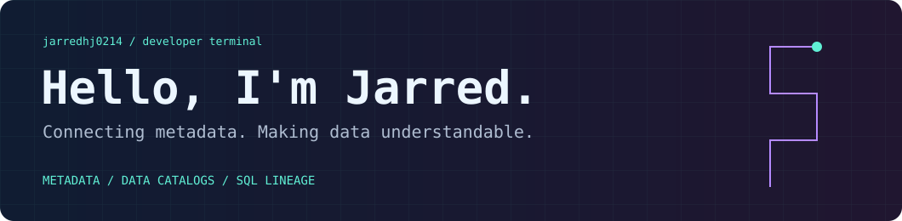

<p align="center">
  
</p>

<p align="center">
  <a href="https://github.com/jarredhj0214/linesql"></a>
  <a href="https://github.com/jarredhj0214?tab=repositories"></a>
</p>

### `01 / ABOUT`

I build tools around **data platforms, metadata, and SQL lineage**.

```java
var jarred = Map.of(
    "focus",    "Data platforms & SQL understanding",
    "building", "LineSQL — JVM-native SQL lineage parser",
    "exploring", "Open data catalogs with Apache Gravitino",
    "toolbox",  "Java / SQL / ANTLR4"
);
```

### `02 / PROJECTS`

| Project | What you'll find |
| :--- | :--- |
| **[LineSQL](https://github.com/jarredhj0214/linesql)** | Turn production SQL into table and column lineage. JVM-native, built with ANTLR4, covering Spark, Hive, Flink, StarRocks and more. |
| **[Gravitino fork](https://github.com/jarredhj0214/gravitino)** | My fork of Apache Gravitino, an open data catalog for federated metadata management. |

### `03 / COMMIT COMBAT`

**Every commit adds a brick to the battlefield.**

<p align="center">
  
</p>

<p align="center"><sub>Real contribution calendar · pixel tanks · looping arcade animation · refreshed daily</sub></p>

---

<p align="center"><code>Understand the data. Build the tools. Keep shipping.</code></p>
